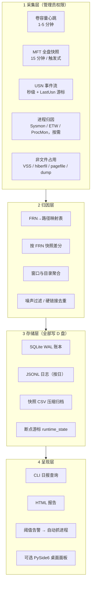

# CDriveSentinel — C 盘空间变化实时监测与归因系统 · 方案设计

| 项目 | 内容 |
|---|---|
| 项目根目录 | `D:\SpaceKnife-local\CDriveSentinel` |
| 文档版本 | v1.0 |
| 日期 | 2026-11-16 |
| 状态 | 方案已确认，待进入实现阶段 |
| 目标平台 | Windows 10 / 11，NTFS 卷，管理员权限 |

---

## 0. 术语与范围

**术语纠正**：日常说的「C 盘内存」实际是 **C 盘的磁盘空间（存储容量）**，与 RAM 内存无关。本文统一使用「磁盘空间」「占用」「分配大小」。

**系统要回答的问题**（用户原始诉求）：

> C 盘的哪个文件夹下的什么内容，在哪天的哪个时间段被写入 C 盘，占用了多少空间。

拆解成可验证的四要素：

| 要素 | 精确定义 | 主数据源 |
|---|---|---|
| 哪里 | 完整路径 + 归属目录（默认聚合到前 3 层） | MFT 快照 + FRN→路径映射 |
| 什么内容 | 单个文件的创建 / 追加 / 覆盖 / 截断 / 重命名 / 删除 | USN 变更日志 |
| 哪天哪个时段 | 事件级 UTC 时间戳（秒）+ 15 分钟归并窗口 | USN 的 `TimeStamp` |
| 占用多少 | 文件**分配大小**（`AllocationSize`）的增量，而非逻辑大小 | 前后两次 MFT 快照差分 |

**明确不在范围内**：自动清理、自动删除、自动移动 C 盘任何文件。本系统只做**只读采集 + 记录 + 报告**。任何清理动作必须由用户逐项确认后单独执行。

---

## 1. 核心结论：为什么必须多源拼接

Windows 没有任何单一机制能同时提供「时间 + 完整路径 + 精确大小 + 操作类型 + 进程名」。微软官方文档确认：

- **NTFS USN 变更日志**提供卷上所有文件和目录变更的持久日志，官方明确说明「比检查时间戳或注册文件通知更高效」。每条记录含 `TimeStamp`（标准 UTC `FILETIME`）、`Reason`（`FILE_CREATE` / `DATA_EXTEND` / `DATA_OVERWRITE` / `DATA_TRUNCATION` / `FILE_DELETE` / `RENAME_OLD_NAME` / `RENAME_NEW_NAME` / `CLOSE` 等）、`FileReferenceNumber`（FRN）、`ParentFileReferenceNumber`、`FileName`。
- 但 `USN_RECORD_V2/V3/V4` 结构里**没有文件大小、没有完整路径、没有进程 ID**。只有文件名和父目录 FRN，完整路径必须靠 FRN 映射表还原。
- 文件大小必须从 MFT 快照或 `GetFileInformationByHandleEx(FILE_STANDARD_INFO)` / `GetCompressedFileSize` 获取；进程名必须靠 Sysmon / ETW / Process Monitor 补充。
- ETW 的 `FileIoWrite` 记录的是**应用发出的 I/O 请求字节**，经缓存管理器后不等于实时落盘字节，因此不能用来做「精确占用」的计量口径，只能用来做归因。

**设计原则**：精确的「占用多少」以快照为准；精确的「什么时候」以 USN 为准；「谁写的」靠按需开启的进程追踪；三者按 FRN 关联，快照同时作为 USN 漏记录的兜底。

---

## 2. 能力边界矩阵（调研结论）

| 机制 | 能提供 | 提供不了 | 本方案定位 |
|---|---|---|---|
| `fsutil usn` / `FSCTL_READ_USN_JOURNAL` / `FSCTL_ENUM_USN_DATA` | 全卷文件级变更持久日志、UTC 时间戳、变更原因标志、FRN、文件名 | 文件大小、完整路径、进程名；日志超过 `MaxSize + AllocationDelta` 会在 NTFS 检查点被裁剪 | 秒级事件流，回答「哪天几点、什么操作」 |
| MFT 直读（WizTree CLI / 自写 `DeviceIoControl`） | 秒级全盘清单、完整路径、逻辑大小/分配大小、修改时间、属性；能正确去重硬链接 | 只是一次快照，不记录变化过程 | 每 15 分钟差分，回答「哪个文件夹、涨了多少字节」 |
| `FileSystemWatcher` / `ReadDirectoryChangesW` | 目录级变更通知 | 内部缓冲区仅 4–64 KB（来自不可分页内存），短时间大量变更会溢出丢事件 | **不适用于整盘监控**，仅可用于个别低变更目录 |
| Sysmon EID 11 / 1 / 26、ETW `Microsoft-Windows-Kernel-File`、Process Monitor | 进程名、PID、命令行、目标文件、写操作 | 全盘常开产生海量事件；Sysmon 自身事件日志写在 C 盘 | 按需短时开启，回答「是谁写的」 |
| `GetDiskFreeSpaceEx` + `vssadmin` + `powercfg` | 卷总量/剩余、卷影副本与还原点占用、休眠文件状态 | 不含文件明细 | 总量曲线 + 解释「文件之和 ≠ 磁盘占用」的差额 |

---

## 3. 总体架构



**数据流向**：采集层各源写入原始表 → 归因层按 FRN 关联、算增量、聚合 → 结构化结果落 SQLite + JSONL → 呈现层按日期/时段查询、生成报告、触发告警。

---

## 4. 采集层详细设计

### 4.1 卷容量心跳

- API：`GetDiskFreeSpaceExW`（Python 用 `ctypes` / `psutil.disk_usage('C:')`），字段 `total / used / free`。
- 频率：默认 60 秒；可配 1–5 分钟。用于画总量曲线、触发「骤降时立即补一次快照」、以及计算归因残差。
- 输出表：`volume_heartbeat`。

### 4.2 MFT 全盘快照（P1 主力）

**首选实现**：调用 WizTree 命令行导出 CSV（直读 NTFS MFT，秒级完成，正确处理硬链接，避免自写 MFT 解析的高风险）。

```powershell
WizTree64.exe "C:" /export="D:\SpaceKnife-local\CDriveSentinel\data\snapshots\c_%d_%t.csv" /admin=1 /exportfolders=0 /sortby=2 /exportUTCTime=1
```

- `%d` / `%t` 是 WizTree 自身占位符（日期/时间），不要交给 PowerShell 展开。
- 导出文件、WizTree 程序本体、临时文件**全部放 D 盘**。
- CSV 至少包含完整路径、逻辑大小、分配大小、修改时间、属性。**解析时按实际表头取值，不要写死列序号**；不同版本参数略有差异，以实现时本机 `WizTree64.exe /?` 为准。
- 频率：默认 15 分钟；卷剩余 5 分钟内下降超过阈值时立即触发一次。
- 保留策略：全量 CSV 压缩归档，最近 48 小时全留 + 每日 1 份留 30 天，其余删除（删除的是**本项目自己的 D 盘归档**）。
  > 注：该条为 P0 方案原文。P1 落地后归档保留改由 `retention_days` 控制（另加 `keep_snapshot_archives=4` 保底最近 4 份）；`retention_days` 于 2026-11-16 由 30 降为 **7**，详见第 5 章 P1 留存策略。

**进阶实现（P2 之后可选）**：用 `DeviceIoControl(FSCTL_ENUM_USN_DATA)` 自解析 MFT，拿到 FRN + 父 FRN + 文件名 + 大小，自行构建路径树。优点是不依赖第三方二进制、能直接拿到 FRN；缺点是结构体解析、重解析点、128 位文件 ID 都要自己处理。**不要在项目初期就走这条路。**

### 4.3 USN 变更日志事件流

- 前置检查：`fsutil usn queryjournal C:` 确认日志激活，记录 `Journal ID` / `FirstUsn` / `NextUsn` / `MaxSize`。若未激活，用 `fsutil usn createjournal m=... a=... C:` 建日志（**只创建，绝不 `deletejournal`**：删除/重建会影响搜索索引、OneDrive、文件历史等依赖方，且耗时可能跨越重启）。
- 读取：`CreateFile("\\\\.\\C:", GENERIC_READ, ...)` → `DeviceIoControl(FSCTL_QUERY_USN_JOURNAL)` → `FSCTL_READ_USN_JOURNAL`，从持久化的 `LastUsn` 增量读；每次读到的第一个 8 字节是「下一次应读取的 USN」，用它推进游标。
- 记录解析：按 `RecordLength` 逐条遍历（记录按 8 字节对齐），**禁止用 `sizeof(USN_RECORD)` 做指针运算**；先读 `MajorVersion` 判断 V2 / V3 / V4 布局（V3 起 FRN 为 128 位 `FILE_ID_128`，建议统一按字符串存储）。`FileName` 用 `FileNameOffset` + `FileNameLength` 取，不能假设有 `\0` 结尾。
- 原因合并：同一句柄打开期间的变更原因会累积在一组记录里，关闭时追加 `USN_REASON_CLOSE` 作为终止标记；重命名会产生旧名/新名两条记录，需配对处理。
- **可靠性**：日志被裁剪时 `FirstUsn` 会前进，若 `LastUsn < FirstUsn` 说明出现缺口 → 标记 `gap`、立即做一次全盘快照重同步，并在日报注明「该时段为快照推断」。
- 断点：每次成功处理后把 `LastUsn` + `Journal ID` 写入 `runtime_state`（事务内），保证重启/崩溃后可续。

### 4.4 进程归因（可选，按需开启）

- **Sysmon**：EID 11 `FileCreate` 记录 `Image` / `ProcessId` / `TargetFilename`；EID 1 提供进程创建与命令行；删除用 **EID 26 `FileDeleteDetected` 而非 EID 23**（23 会归档被删文件，在磁盘紧张时反而加速爆盘）。配置用 `onmatch="include"` 只圈定可疑目录，且校验本机 `schemaversion`（`sysmon -? config`）。同一字段多条件为 OR、不同字段为 AND，过滤要窄。
- **ETW**：`Microsoft-Windows-Kernel-File` / `KernelTraceEventParser` 的 `FileIO`、`FileIOInit`、`PROC_THREAD` 关键字，带 PID；只做 10–30 分钟定向抓取，注意异步 I/O、内存映射、缓存写回会造成上下文丢失。
- **Process Monitor**：图形界面设过滤 `Operation is WriteFile` + `Path begins with C:\`，短时抓取定位反复写盘进程；适合一次性排查。
- **快速判断**：任务管理器「详细信息」勾选 `I/O 写入字节`、资源监视器「磁盘」页，先看哪个进程的写入计数在涨。

### 4.5 非文件系统占用（解释差额）

每小时只读采集一次，用于日报的「未归因」项与解释：

```powershell
vssadmin list shadowstorage                 # 还原点 / 卷影副本占用
vssadmin list shadows
powercfg /a                                  # 休眠状态（hiberfil.sys）
fsutil volume diskfree C:
dism /Online /Cleanup-Image /AnalyzeComponentStore   # 只读分析 WinSxS，不做清理
```

常见隐藏占用：`hiberfil.sys`（约等于 RAM 的一定比例）、`pagefile.sys`、`swapfile.sys`、`C:\Windows\MEMORY.DMP` 与 `Minidump`、`System Volume Information`、簇对齐 slack、备用数据流、MFT 自身增长、OneDrive 占位文件水化。

---

## 5. 归因层算法

```
输入: 上一快照 S_prev(frn -> {path, logical, allocated, mtime})
      新快照 S_now
      USN 事件窗口 E = (S_prev.ts, S_now.ts]
      卷心跳 used_prev, used_now

1. 构造 FRN→完整路径映射表（由 S_now 的 parent_frn 递归拼接）
2. 按 FRN 对齐（不用路径对齐，避免重命名被算成一删一增）:
     frn 仅在 S_now              -> CREATE   delta = +allocated_now
     frn 两者都有 & alloc 变化   -> EXTEND / TRUNCATE  delta = alloc_now - alloc_prev
     frn 仅在 S_prev             -> DELETE   delta = -allocated_prev
     frn 相同但 path 变化        -> RENAME   delta = 0（只记事件，不计空间）
     硬链接: 按 FRN 只计一次
3. 用 E 中同 FRN 的记录补全: 精确 UTC 时间、reason_mask、op 细分、进程名
   E 中没有对应 FRN 的文件  -> evidence = "snapshot"，confidence = "medium"
   两者都有                  -> evidence = "usn+snapshot"，confidence = "high"
4. 按 15 分钟窗口 + 目录深度（默认 3 层）聚合 delta，取 Top N
5. 残差 residual = (used_now - used_prev) - Σdelta
   单独作为「未归因」行输出，并关联 4.5 的非文件占用数据做解释
6. 白名单过滤: 本项目自身在 D 盘的写入、Sysmon 事件日志、搜索索引等已知噪声
   （只做标记与折叠，不删除原始事件）
```

**口径约定**：一律用 `AllocationSize`（簇对齐后的实际占用；压缩/稀疏文件用 `GetCompressedFileSize`），而非 `EndOfFile` 逻辑大小。这样报告里的字节数才能和 Windows 报的剩余空间对得上。误差目标：单文件 ≤ 1 个簇（通常 4 KiB）。

---

## 6. 存储层设计

### 6.1 目录结构

```
D:\SpaceKnife-local\CDriveSentinel\
  docs\            DESIGN.md（本文档）
  src\             main.py / collector\ / usn\ / snapshot\ / diff\ / report\ / alert\
  data\            sentinel.db（SQLite WAL）
                   snapshots\*.csv.gz
                   logs\YYYY-MM-DD.jsonl
  config\          config.yaml / whitelist.yaml / sysmon-config.xml
  tools\           WizTree64.exe / Sysmon64.exe / Procmon.exe
  reports\         daily\YYYY-MM-DD.html
  install_task.ps1 / run.ps1 / requirements.txt
```

**P1 实际落地结构**（2026-11-16）：

```
D:\SpaceKnife-local\CDriveSentinel\
  docs\DESIGN.md
  src\  p0_baseline.py  p0_scan.py
        p1_config.py  p1_snapshot.py  p1_db.py  p1_diff.py  p1_report.py
        p2_probe.py  p2_usn.py  p2_store.py  main.py
  config\config.json
  data\  sentinel.db  run.log  snapshots\*.csv.gz  logs\YYYY-MM-DD.jsonl
  reports\daily\YYYY-MM-DD.txt / .html
  run_p0.ps1  run_p1.ps1  install_task.ps1
  tools\  （WizTree64.exe 可选，P1 不使用）
```

**硬性约束**：`data\` 与 `reports\` 全部位于 D 盘。若把日志写回 C 盘，监控系统会自己制造空间增长，形成自激。`p1_config.paths()` 在启动时校验 `data_root` 盘符，若与被监控卷相同会直接拒绝运行。

### 6.2 SQLite DDL（核心表）

```sql
CREATE TABLE volume_heartbeat (
  id           INTEGER PRIMARY KEY,
  ts_utc       TEXT NOT NULL,
  ts_local     TEXT NOT NULL,
  total_bytes  INTEGER NOT NULL,
  used_bytes   INTEGER NOT NULL,
  free_bytes   INTEGER NOT NULL
);

CREATE TABLE snapshot_meta (
  id                   INTEGER PRIMARY KEY,
  ts_utc               TEXT NOT NULL,
  source               TEXT NOT NULL,          -- wiztree | usn_enum
  csv_path             TEXT,
  file_count           INTEGER,
  total_allocated      INTEGER,
  usn_cursor           INTEGER,
  journal_id           TEXT
);

CREATE TABLE frn_path_map (
  frn          TEXT NOT NULL,                 -- V3/V4 为 128 位，统一存字符串
  parent_frn   TEXT,
  name         TEXT NOT NULL,
  full_path    TEXT NOT NULL,
  valid_from   TEXT NOT NULL,
  valid_to     TEXT,
  PRIMARY KEY (frn, valid_from)
);

CREATE TABLE file_state (
  frn            TEXT NOT NULL,
  snapshot_id    INTEGER NOT NULL,
  path           TEXT NOT NULL,
  logical_size   INTEGER,
  allocated_size INTEGER,
  mtime_utc      TEXT,
  attributes     INTEGER,
  is_dir         INTEGER DEFAULT 0,
  PRIMARY KEY (frn, snapshot_id)
);

CREATE TABLE change_event (
  id             INTEGER PRIMARY KEY,
  ts_utc         TEXT,
  ts_local       TEXT,
  window_start   TEXT,
  window_end     TEXT,
  frn            TEXT,
  path           TEXT,
  top_dir        TEXT,
  op             TEXT,      -- CREATE | EXTEND | OVERWRITE | TRUNCATE | DELETE | RENAME
  reason_mask    INTEGER,
  logical_size   INTEGER,
  allocated_size INTEGER,
  delta_bytes    INTEGER,   -- 正为增长，负为释放
  process        TEXT,
  pid            INTEGER,
  evidence       TEXT,      -- usn+snapshot+sysmon | usn+snapshot | snapshot
  confidence     TEXT,      -- high | medium | inferred
  note           TEXT
);

CREATE TABLE runtime_state (
  key    TEXT PRIMARY KEY,
  value  TEXT NOT NULL       -- LastUsn / JournalId / LastSnapshotId / ...
);

CREATE INDEX idx_event_window ON change_event(window_start);
CREATE INDEX idx_event_dir    ON change_event(top_dir);
CREATE INDEX idx_event_delta  ON change_event(delta_bytes);
CREATE INDEX idx_event_frn    ON change_event(frn);
```

**P1 实现相对上述设计 DDL 的增补**（兼容，不删列）：`snapshot_meta` 增加 `ts_local / root / scope_hash / partial / pruned / used_bytes / free_bytes / total_bytes / cluster_size / elapsed_seconds / stats_json`，用于判定快照可比性与计算残差；`change_event` 增加 `prev_snapshot_id / curr_snapshot_id` 用于按窗口精确回溯；另增 `diff_run`（窗口级账本，含 `used_delta / attributed_delta / residual_bytes`）与 `alert` 两张表。`file_state` 只保留最近 2 个快照，完整逐文件清单每天归档一份 gzip CSV。

**P2 增量表**：`usn_poll`（每次轮询账本：action / status / 起止 USN / Journal ID / 记录数 / 版本分布 / win_error）、`usn_event`（秒级事件：FRN、parent FRN、名称、解析后路径、top_dir、UTC 与本地时间、reason_mask、原因名、op、记录版本、聚合条数、linked）、`mft_index`（`FSCTL_ENUM_USN_DATA` 构建的 FRN→parent/name/is_dir 索引）。`change_event` 另增 `usn_usn / usn_time_utc / usn_reason_names` 三列，用于把快照事件升级为高置信证据。所有新增列通过 `PRAGMA table_info` 检查后 `ALTER TABLE` 追加，兼容 P1 已有数据库。

### 6.3 日志规范

`data/logs/YYYY-MM-DD.jsonl`，一行一事件，UTF-8，追加写，按日轮转，保留 90 天（清理操作只针对本项目自己在 D 盘的日志）。

**采集器运行日志 `data/run.log` 永远不能被 stdout 卡死**（2026-11-25 事故）。计划任务启动的进程，stdout 是一条没人读的管道：管道写满时 `print()` **不抛异常，而是永久阻塞**，`except (OSError, ValueError)` 抓不到。当天守护进程就死在 `log()` 的 `print()` 里（py-spy：`log <- UsnJournal.open <- run_usn_poll`），连带 `run.log` 一行没写（文件写当时排在 print 之后）。现行实现：`log()` **先写文件、再尽力回显**；回显走一条有界队列（2000 行）+ 一条 daemon 泵线程，用 `os.write(1, ...)` 直接写 fd（不碰 `sys.stdout` 的 buffered 锁，避免进程退出时 `_enter_buffered_busy` 致命错误）；队列满就丢行，采集主循环永远不阻塞。

```json
{"ts_local":"2026-11-16 02:13:47","window":"2026-11-16 02:00~02:15","volume":"C:","frn":"0x0000000000012ab3","path":"C:\\Windows\\SoftwareDistribution\\Download\\8f3a.cab","top_dir":"C:\\Windows\\SoftwareDistribution","op":"CREATE","reason_mask":258,"logical_size":2147483648,"allocated_size":2147486720,"delta_bytes":2147486720,"process":"svchost.exe","pid":3212,"evidence":"usn+snapshot+sysmon","confidence":"high","note":"Windows 更新缓存"}
```

**后台采集进程必须是无窗口的**（2026-11-25 事故）。计划任务启动的是**控制台**程序时，Windows 会给它一个真实的控制台窗口（标题就是 exe 全路径）。关闭那个窗口 = `CTRL_CLOSE_EVENT`，默认处理直接终止进程：退出码 `0xC000013A`（`STATUS_CONTROL_C_EXIT`），没有 traceback、`run.log` 里也没有 `FATAL`，任务状态悄悄回到 Ready —— 采集从此不再运行，而界面上看不出来。当天就是这么丢的（17:09:07，`LastTaskResult = 3221225786`）。现行方案：**同一个采集器编译两份**，`CDriveSentinel.exe`（console，供 status/report/selftest 打印）与 `CDriveSentinelDaemon.exe`（`console=False`，任务里跑的就是它，没有任何窗口可关）；入口 `src/daemon_win.py` 只把 argv 固定成 `daemon`。注意 `New-ScheduledTaskSettingsSet -Hidden` 只隐藏**任务**，不隐藏窗口，别指望它。
无窗口还有个副作用要记住：安装器升级前用 Restart Manager 请占用文件的进程自行关闭，而**没有消息泵的进程收不到这个请求**，Setup 会弹 "unable to automatically close all applications"。所以安装器改成 `CloseApplications=no`，复制文件前用 `StopCollector()`（停任务 + 结束进程）自己解决，和 `install.ps1` 的 `Stop-Running` 同一套动作。

`reason_mask` 示例 `258 = 0x102 = FILE_CREATE(0x100) | DATA_EXTEND(0x2)`。

**人读日报**（`reports/daily/YYYY-MM-DD.html` 与 CLI 输出）：

```
2026-11-16  C: 可用 238.4 GB → 231.7 GB（-6.7 GB）
02:00-02:15  +4.2 GB  C:\Windows\SoftwareDistribution\Download  [更新缓存]
             ├ 8f3a.cab              +2.00 GiB  CREATE  svchost.exe
             └ windows11.0-kb.msu    +1.60 GiB  CREATE  svchost.exe
09:30-09:45  +1.8 GB  C:\Users\15493\AppData\Local\Temp
14:00-14:15  +0.6 GB  C:\Windows\WinSxS  [组件存储，硬链接已去重]
未归因 +0.1 GB（卷影副本 / 簇对齐 / 系统保留）
```

「未归因」行是刻意保留的诚实口径：不把它硬摊到某个目录上。

### 6.4 配置示例（`config/config.yaml`）

```yaml
volume: "C:"
data_root: "D:\\SpaceKnife-local\\CDriveSentinel"
heartbeat_seconds: 60
snapshot_minutes: 15
window_minutes: 15
top_dir_depth: 3
trigger_snapshot_drop_mb: 1024
alert_free_gb_below: 10
alert_growth_gb_per_hour: 2
retention:
  snapshots_full_hours: 48
  snapshots_daily_days: 30
  logs_days: 90
process_attribution:
  enabled: false          # 默认关闭，告警或手动排查时开启
  method: "sysmon"        # sysmon | etw | procmon
wiztree:
  exe: "tools\\WizTree64.exe"
  admin: 1
```

---

## 7. 技术栈与部署

**技术栈**：Python 3.11+；`pywin32`（`win32file` / `win32con` / `win32api`）、`psutil`、`ctypes`（`DeviceIoControl` 与 USN 结构体）；SQLite（`sqlite3` 标准库，WAL 模式）；报告用纯 HTML 模板；桌面面板可选 **PySide6**（与现有项目技术栈一致）。

**P1/P2 落地说明**：两期都坚持零第三方依赖，仅用 Python 3.13 标准库 + `ctypes`（`GetDiskFreeSpaceExW / GetCompressedFileSizeW / CreateFileW / DeviceIoControl`），配置用 JSON。原方案中的 `pywin32 / psutil` 已被 ctypes 取代，`PySide6` 仍属 P3 可选。USN 结构体不使用预编译 struct，而是按 `RecordLength` 运行时遍历以兼容 V2/V3/V4。计划任务见第 9 章与 `install_task.ps1`。

**依赖安装（P2/P3 可选）**：

```powershell
python -m venv "D:\SpaceKnife-local\CDriveSentinel\.venv"
D:\SpaceKnife-local\CDriveSentinel\.venv\Scripts\pip.exe install pywin32 psutil
```

**计划任务**（开机自启、最高权限）：

```powershell
$root = "D:\SpaceKnife-local\CDriveSentinel"
$action = New-ScheduledTaskAction -Execute "$root\.venv\Scripts\python.exe" `
          -Argument "$root\src\main.py --mode daemon" -WorkingDirectory $root
$trigger = New-ScheduledTaskTrigger -AtLogOn
$principal = New-ScheduledTaskPrincipal -UserId "SYSTEM" -LogonType ServiceAccount -RunLevel Highest
Register-ScheduledTask -TaskName "CDriveSentinel" -Action $action -Trigger $trigger -Principal $principal -Force
```

**CLI 约定**：

```
python src\main.py --mode daemon                        后台常驻
python src\main.py --mode snapshot                     手动补一次快照
python src\main.py report --day 2026-11-16             生成日报
python src\main.py report --since "2026-11-16 02:00" --until "2026-11-16 03:00" --top 20
python src\main.py trace --minutes 10                  临时开启进程归因抓取
```

**权限**：USN 日志查询、MFT 直读、VSS 查询均需管理员；进程需以最高权限运行。被占用/拒绝访问的路径要捕获异常并计入 `note`，不能让单次失败中断守护进程。

---

## 8. 告警规则

| 条件 | 动作 |
|---|---|
| 剩余空间 < 10 GB | 立即补一次快照 + 生成报告 + 托盘/桌面通知 |
| 1 小时内卷占用增长 > 2 GB | 立即补快照；若 `process_attribution.enabled` 允许，自动开启 10 分钟进程归因抓取 |
| USN `Journal ID` 变化或 `LastUsn < FirstUsn` | 标记 gap，全盘快照重同步，日报注明「推断」 |
| 本项目日志/数据库日增长 > 50 MB | 自检告警（防止自激或采样过密） |

告警一律只通知与记录，**不执行任何清理**。

---

## 9. 分期实施与验收

### P0 · 基线采集（已完成，只读一键脚本）

已落地为 `src\p0_baseline.py`（编排/采集/报告）、`src\p0_scan.py`（只读目录扫描、分配大小估算、硬链接去重）、`run_p0.ps1`（启动器）。纯 Python 标准库，零第三方依赖，所有产物写入 `data\baseline\`，**不写被监控卷**。

运行方式（建议管理员终端）：

```powershell
powershell -ExecutionPolicy Bypass -File .\run_p0.ps1
# 或
python src\p0_baseline.py --scan-depth 2 --max-seconds 400
# 快速冒烟测试
python src\p0_baseline.py --no-scan --no-wiztree
```

产物：`baseline_<时间戳>.json`（schema `cdrivesentinel.baseline.v1`）、`baseline_<时间戳>.md`（人读报告）、`raw\*.txt`（命令原始输出）、`run.log`。把 `WizTree64.exe` 放入 `tools\` 后，脚本会优先用 MFT 直读生成秒级 CSV 快照并跳过内置扫描。

只读采集现状、建立第一张基线快照，不改 C 盘任何文件：

```powershell
Get-PSDrive C | Select-Object Used,Free
fsutil usn queryjournal C:
vssadmin list shadowstorage
powercfg /a
WizTree64.exe "C:" /export="D:\SpaceKnife-local\CDriveSentinel\data\snapshots\c_%d_%t.csv" /admin=1
```

辅助排查：FolderChangesView 挂 `C:\Users`、`C:\Windows\Temp` 等目录导出 CSV；Process Monitor 过滤 `WriteFile` 抓 10 分钟；任务管理器/资源监视器看写入计数在涨的进程。

### P1 · 快照差分守护进程（已实现，只读）

定时快照 → gzip CSV 归档 → SQLite `file_state` → 按 FRN 差分 → 目录/窗口聚合 → 日报 CLI + HTML + JSONL 日志。**交付后即可回答「哪天哪个时段、哪个文件夹、涨了多少」**，覆盖约 90% 诉求。

#### 交付文件

| 文件 | 作用 |
|---|---|
| `src\main.py` | 统一 CLI：`init-db / snapshot / heartbeat / daemon / report / status / selftest` |
| `src\p1_config.py` | 配置加载、**输出盘符硬校验**（数据目录不得落在被监控卷） |
| `src\p1_snapshot.py` | 逐文件只读枚举：NTFS 文件 ID、分配大小、mtime、重解析点跳过、硬链接去重、超时标记（`dirinfo` / `stat` 两套后端） |
| `src\p1_fastdir.py` | 目录项直读：`NtQueryDirectoryFile` + `FILE_ID_BOTH_DIR_INFORMATION` 一次取一层目录的全部元数据（名字、FRN、属性、大小、mtime），不需要逐文件 `os.stat` |
| `src\p1_db.py` | SQLite WAL 建库、心跳/快照/事件/账本/告警表、批量写入、保留清理 |
| `src\p1_diff.py` | FRN 归并差分、事件分类、JSONL 日志、`diff_run` 残差账本、告警 |
| `src\p1_report.py` | 日报文本 + HTML、按目录/窗口/单文件聚合、当前占用 Top |
| `config\config.json` | 采样节拍、扫描范围、Top 深度、保留期、告警阈值 |
| `run_p1.ps1` / `install_task.ps1` | 启动器 / 登录自启计划任务（最高权限） |
| `data\sentinel.db` / `data\snapshots\*.csv.gz` / `data\logs\*.jsonl` / `reports\daily\*` | 运行产物，全部在 D 盘 |

#### 运行方式（管理员终端优先）

```powershell
cd D:\SpaceKnife-local\CDriveSentinel
python src\main.py init-db                       # 建库 + 首个心跳
python src\main.py snapshot                      # 手动补一次快照（首次为基线）
python src\main.py daemon --once                 # 跑一个调度周期
python src\main.py daemon                        # 常驻：心跳 60s，快照 30min
python src\main.py report --day 2026-11-16 --top 20
python src\main.py report --since "2026-11-16 02:00" --until "2026-11-16 03:00"
python src\main.py status                        # 数据库概况
python src\main.py selftest                      # D 盘沙箱端到端验收，不碰 C 盘
powershell -ExecutionPolicy Bypass -File .\install_task.ps1   # 注册登录自启
```

`--scope "C:\Users"` 可重复指定，用来把扫描范围收窄到重点目录；`--interval 15` 调整快照间隔，`--max-seconds` 调整单次扫描时间预算。

#### 日报自动生成与门户页（2026-11-17 增补）

- **三种呈现**：调用 `report` 时同时产出 CLI 屏幕输出（临时查看）、`reports\daily\YYYY-MM-DD.txt`（留档/脚本）、`reports\daily\YYYY-MM-DD.html`（日常阅读，表格 + 红涨绿跌 + 条形图）；`--no-html` 可只出 txt。
- **门户首页** `reports\index.html`：一页看最近 7 天日报链接、卷已用变化、USN 事件数、告警数、采集/快照状态；每 10 分钟自动刷新。由 `report` 与每次快照完成后自动重写。
- **自动生成**：daemon 每天在 `daily_report_hour`（默认 8 点）之后，为**昨天**生成一次完整日报并刷新门户（昨天数据完整、避免跨日中途出报告）。生成日期写入 `runtime_state.report.last_auto_day`，重启不重复生成；生成失败只记日志、不影响采集。可用 `daily_report_enabled` 关闭、`daily_report_top` 调整 Top 数。
- **半成品快照护栏**：`snapshot_meta` 在扫描开始时即插入（`file_count IS NULL`），完成时回填。`status` 与报告的「当前占用 Top」只取 `file_count IS NOT NULL` 的最新快照；若有扫描中的快照，报告显式注明「正在扫描中，数据取自上一次完整快照」，避免只显示已扫描目录的误导值。

#### 与设计的偏差及理由（重要）

1. **零第三方依赖**：P1 延续 P0 风格，只用 Python 标准库（`ctypes / sqlite3 / gzip / csv`），配置用 JSON 而非 YAML。设计文档中的 `pywin32 / psutil / PySide6` 推迟到 P2/P3，避免为了跑监控先装环境。
2. **快照源只用内置扫描器**：WizTree CSV 不含 NTFS 文件 ID（FRN），而 P1 的差分正确性完全依赖 FRN 对齐；用它会导致重命名被误算成一删一增。故 P1 不导入 WizTree CSV，WizTree 仍用于 P0 的秒级现状盘点，P2 再改用 `FSCTL_ENUM_USN_DATA` 直读 MFT。
3. **窗口以快照对为真实区间**：`change_event.window_start/end` 存 `(上一快照, 本次快照]` 的精确区间，`diff_run` 一行一个窗口；报告按此区间列出目录增量。`window_minutes` 保留给心跳曲线分桶与 P2 的 USN 聚合。
4. **`OVERWRITE`（大小未变、mtime 变化）只计数不逐条落库**：避免每次快照产生大量 `delta=0` 事件撑爆数据库；计数写入 `diff_run` 的操作分布。
5. **快照可比性护栏**：`scope_hash` 不同、`partial=1`（超时）、或 `file_state` 已被保留策略裁剪的快照不会被当作差分前序，直接建立新基线，杜绝虚假的「全盘新增/删除」。

#### 实现要点

- **归并差分**：`SELECT ... FROM file_state WHERE snapshot_id=? ORDER BY frn` 两个游标流式归并，内存只存当前两行，951k 文件无需全量载入。
- **FRN 来源**：目录项直读（`p1_fastdir` → `NtQueryDirectoryFile` + `FILE_ID_BOTH_DIR_INFORMATION`，2026-11-25 起默认后端）或 `os.stat().st_ino` 回退（`DirEntry.stat()` 在 Windows 恒为 0，这是 P0 实测踩过的坑；非 NTFS 卷或非 Windows 上仍走这条路）；取不到时用路径哈希兜底并计数。硬链接按 FRN 去重。
- **口径**：`allocated_size()` 复用 P0（簇对齐；压缩/稀疏调 `GetCompressedFileSizeW`）；重命名 `delta=0`，只记 `RENAME` 并更新 `frn_path_map`。
- **残差**：`residual = (used_now - used_prev) - Σdelta`，独立写入 `diff_run` 并在日报单列「未归因」，不摊派到目录。
- **时间**：UTC 与本地时间由同一个 `datetime` 推导（修正 P0 基线里二者相差数分钟的问题）。
- **自激防护**：`p1_config.paths()` 拒绝把 `data_root` 放在被监控盘；`_alerts` 在本项目数据目录超过 `data_size_alert_mb`（默认 1024 MiB）时告警；所有产物只在 D 盘。
- **留存策略**：`file_state` 只保留最近 **2** 个快照（差分所需的最小集合），其余删除并置 `pruned=1`，被裁剪的快照不再作为差分前序；完整逐文件清单按 `archive_mode=daily` **每天只归档一份** gzip CSV（约 22 MiB/份），另保留最近 4 份，超过 `retention_days` 的归档删除。`retention_days` 于 2026-11-16 由 30 降为 **7**（同时作用于 `change_event` / `alert` / `volume_heartbeat` 明细与每日归档）。稳态占用约：`file_state` 455 MiB + 每日归档 22 MiB × 7 天 ≈ 154 MiB，**日增长约 22 MiB**，满足验收用例 6 的「日增长 < 50 MB」；叠加 P2 的 `mft_index` 148 MiB 与 7 天 `usn_event` 314 MiB 后，数据目录稳态约 1.07 GiB（P2.3 的 F20 因此把 `data_size_alert_mb` 提到 1280）。
- **数据库页回收**：SQLite 删除行后不会自动缩小文件，第三次快照时因此一度涨到 704 MiB。实现 `PRAGMA auto_vacuum=INCREMENTAL`（建库时设置）+ 每次 `prune()` 后 `PRAGMA incremental_vacuum`；已有库用 `python src\main.py maintenance` 一次性转换并 VACUUM（实测 `704.07 MiB → 455.42 MiB`，回收 248.66 MiB）。此后每次快照自动回收空闲页，文件稳定在约 455 MiB。
- **只读**：全程只调用 `NtQueryDirectoryFile / CreateFileW(FILE_LIST_DIRECTORY) / os.stat / GetDiskFreeSpaceExW`，不创建、修改、删除 C 盘任何文件。

#### 扫描性能（2026-11-25：全盘 1656 s → 61.5 s）

**旧实现为什么慢**：`_rows_stat` 为了拿到 NTFS 文件 ID，对**每个文件**调一次 `os.stat()`。在 Windows 上这等于 `CreateFileW` + 查 `FileIdInformation` + `CloseHandle`，一条约 1 ms 量级的随机元数据访问；103 万文件就是一千多秒（实测 625–1125 files/s，`elapsed=1656.1 s`）。文件内容一个字节都没读，时间全花在「逐文件打开」上。

**WizTree 为什么快**：它不遍历目录树，而是**顺序读整份 `$MFT`**（1M 文件约 1–2 GB），在内存里解析 1 KB 一条的 FILE 记录。顺序读盘 + 纯内存解析，1–3 分钟很正常；代价是**必须要管理员权限**（直接打开卷），而且只能用于 NTFS。

**现在的做法**（`src\p1_fastdir.py`）：每层目录只开一次句柄（`CreateFileW(FILE_LIST_DIRECTORY | FILE_FLAG_BACKUP_SEMANTICS)`），再用 `NtQueryDirectoryFile(FileInformationClass=37 /*FileIdBothDirectoryInformation*/)` 一次取回整层目录的全部元数据：文件名、64 位 FRN、属性、`EndOfFile`、`AllocationSize`、`LastWriteTime`。每个文件的元数据都是**枚举目录时顺带返回的**，不再有任何逐文件 open，也不需要管理员权限。

实测（同一台机器、非管理员、后台还有一个旧版守护进程在扫，属于有干扰的保守值）：

| 路径 | 耗时 | 说明 |
|---|---|---|
| 旧 `stat` 后端，全盘 | **1656.1 s** | 1,034,804 文件 / 200,093 目录 |
| 新 `dirinfo` 后端，全盘枚举 | **40.8 s** | 1,169,673 行（982,697 文件 + 186,977 目录，硬链接去重 82,992） |
| 新 `dirinfo` 后端 + SQLite staging | **61.5 s** | 1,169,677 行入库，临时库 96.5 MiB |
| 微基准 `C:\Windows\WinSxS`（27,921 项） | 0.088 s vs 2.34 s | 目录项直读 vs 逐项 `os.stat`，约 27× |

**等价性**：`tools\verify_backends.py` 对同一棵树跑两套后端逐行比对（FRN、路径、逻辑/分配大小、mtime、属性、is_dir）。`C:\Windows` 全树 167,082 行、`System32` 23,834 行、`drivers` 721 行均为 `only_dirinfo=0 only_stat=0`；唯一差异是两趟之间**正在被写入**的 `winevt\Logs\*.evtx`、`wiatrace.log` 的 size/mtime，属文件真在变化，不是口径差异。因此升级后第一次快照不会把全盘误报成「都变了」。

**两个必须记住的坑**（`p1_fastdir.py` 里都加了注释）：

1. `NtQueryDirectoryFile` 会返回 `.` 和 `..` 两个目录项，`os.scandir` 是滤掉的。递归遍历若信任它们会自己套自己无限递归（路径越走越长、条目重复计数），必须在 `_query` 里丢掉。
2. 128 KiB 的返回缓冲区**必须每线程一份**（`threading.local()`）：多个线程共用一个缓冲区时，内核正在往里写、另一个线程正在解析，会读出乱码名字和错误属性位。

另外目录项里的 `AllocationSize` 实测恒为 0（哪怕是 339 KB 的文件），所以分配大小仍按簇对齐公式计算，压缩/稀疏文件继续走 `GetCompressedFileSizeW`。

**回退**：非 Windows、非 NTFS、或 `available()` 探测失败时自动退回 `stat` 后端，原因写进 `stats().backend_detail` 并随快照落库，行为与旧版完全一致。

#### 验收结果（2026-11-16）

`python src\main.py selftest` 在 D 盘沙箱构造「新建 3 MiB / 追加 2 MiB / 删除 0.25 MiB / 重命名 / 硬链接」，跑两次快照后 **7/7 检查通过**：CREATE/EXTEND/DELETE 的字节数精确到字节、RENAME 的 `delta=0` 且旧名不产生事件、硬链接只计一次、`diff_run.attributed_delta` 与手工合计一致。沙箱在结束后自动清理，C 盘零写入。

#### 真机实测（2026-11-16，非管理员，全盘三次快照 / 两个差分窗口）

| 项目 | 值 |
|---|---|
| 快照 #1 / #2 | 952,115 / 952,128 个文件，183,512 / 183,514 个目录，各去重 77,937 个硬链接，拒绝访问 214 处 |
| 扫描耗时 / 合计 | 297 s / 284 s；129.42 GiB / 128.68 GiB |
| 差分窗口 | `14:41:16 ~ 14:47:20`（364 s），275 个事件：CREATE 109 / DELETE 96 / EXTEND 67 / TRUNCATE 2 / RENAME 1 |
| 账本 | 卷已用 `+17.79 MiB`，已归因 `-755.38 MiB`，**未归因 `+773.17 MiB`** |
| 点名的变化 | `C:\Users\15493` 净 `-760.72 MiB`：两个安装包 `@genieworkbuddy-desktop-updater\installer.exe`(-438.52 MiB) 与 `app_shell_cache_6383\app_package_6e037c6580.exe`(-356.50 MiB) 被删除；同期 `CodeSetup-stable-3.30.14.exe.tmp` +21.62 MiB、微信日志 +3.58 MiB、事件日志 +5.39 MiB |
| 自身占用 | `sentinel.db` 466 MiB（190 万行 `file_state`）、gzip 快照 22 MiB/份、JSONL 126 KiB |

**第二个差分窗口 `14:47:20 ~ 15:15:41`（1701 s，快照 #2→#3）**：953,939 个文件、去重 82,003 个硬链接、扫描 538 s；3,972 个事件，卷已用 `+1.27 GiB`、已归因 `+2.15 GiB`、未归因 `-901.78 MiB`。这段正是用户关心的「C 盘又涨了什么」，系统直接点名：

| 变化 | 路径 |
|---|---|
| **+1.44 GiB EXTEND** | `C:\pagefile.sys`（页面文件动态增长，本期最大单项） |
| +198.32 MiB CREATE | `%LOCALAPPDATA%\Temp\vscode-stable-user-x64-np2ugc9dnf\CodeSetup-stable-3.30.14.exe` |
| +76.68 / +42.30 / +41.89 / +31.88 MiB | `C:\Users\15493\.workbuddy\workspace\sessions\...\modify_backup_v2\commits\49054095\snapshots\` 下的会话文件备份 |
| +63.67 / +19.68 / +19.64 MiB | `%LOCALAPPDATA%\Temp\_MEI000077542\`（PyInstaller 临时解压：ONNX 模型、PySide6 DLL） |
| +20.26 / +20.04 MiB | 微信日志 `mm_20261116.xlog`、`.workbuddy\logs\sandbox\...log` |

按目录聚合：`C:`（卷根，`pagefile.sys`）`+1.44 GiB`、`C:\Users\15493` `+724.13 MiB`。该窗口的扫描结束心跳显示扫描期间卷用量又变化 `-221.81 MiB`，日报已显式标注采样错位。**这些只是点名与记录，系统不清理任何文件**；是否处理需用户逐项确认。

**关键观察（第一窗口）**：文件层面少了约 795 MiB，卷已用却不降反升 17.79 MiB，残差 773 MiB。这正是设计里保留「未归因」行的意义：删除大文件后空间未释放，通常指向卷影副本/还原点、系统保留区或删除挂起；报告如实列出残差，而不是把它摊到某个目录上。内置扫描耗时约 5 分钟，卷用量在快照**开始**时刻取样而文件清单在整个区间内采集，二者存在采样错位，也会放大残差 —— 日报已显式标注，P2 的 MFT 直读（秒级一致性）可消除该误差。

#### 已知局限

- 未放 WizTree 且非管理员时，全盘扫描耗时数分钟（本次机器约 951k 文件）；建议用 `scope` 收窄或把间隔调到 30–60 分钟。守护进程有 `max_scan_seconds` 超时保护，超时的快照只做基线不参与差分。
- **采样错位**：卷用量在快照开始时刻取样，逐文件清单在长达数分钟的扫描区间内采集；报告已显示两次扫描耗时和扫描结束时刻的卷用量变化，但残差仍可能包含该错位。管理员 + `vssadmin list shadowstorage` 只读查询可进一步缩小残差。
- 权限跳过的目录（如 `System Volume Information`）无法进入，其变化落入「未归因」；以管理员运行可缩小该残差。
- 硬链接按 FRN 只计一次，归属到**枚举时遇到的首个路径**；因遍历顺序不同，`WinSxS / System32` 的目录级占用可能与 P0 或 WizTree 报告略有差异，但卷总量与两次快照间的差分增量一致。P2 直读 MFT 时可引入规范路径归一化解决。
- P1 无 USN 事件流，`evidence=snapshot`、`confidence=medium`，时间精度是快照间隔而非秒级；单文件 `reason_mask / process / pid` 留空，由 P2 补齐。
- 告警目前只记录到 `alert` 表与日报，不做桌面通知、不做任何清理动作。

### P2 · USN 事件流（已实现，读取记录需管理员）

`FSCTL_READ_USN_JOURNAL` 增量读取、FRN→路径映射、原因标志解析、`LastUsn` 持久化、gap 重同步、事件与快照关联。精确到秒级单文件与操作类型。

#### 交付文件

| 文件 | 作用 |
|---|---|
| `src\p2_probe.py` | 只读权限诊断：卷句柄组合、FSCTL 可用性、`fsutil` 对照、记录窥探 |
| `src\p2_usn.py` | ctypes 卷句柄、QUERY/READ/ENUM、`USN_RECORD_V2/V3/V4` 解析、UTC FILETIME、Reason 表、游标/gap 状态机 |
| `src\p2_store.py` | `usn_poll / usn_event / mft_index` 表、按 (FRN, op) 聚合、路径解析、P1 事件证据升级 |
| `src\main.py` | 新增 `usn-status / usn-poll / usn-index`；`daemon` 每 30 s 轮询；`selftest` 扩展 P2 用例 |
| `src\p1_report.py` | 日报新增「USN 秒级事件流」章节与权限状态提示 |

#### 运行方式

```powershell
python src\main.py usn-status              # 权限 / journal / 游标诊断（无需管理员）
python src\main.py usn-poll                # 增量读取（需要管理员）
python src\main.py usn-index               # 构建 FRN→路径 MFT 索引（需要管理员）
python src\main.py daemon                  # 常驻：心跳 60s、USN 30s、快照 30min
python src\main.py report --day 2026-11-16
```

#### 联网与本机查证结论

1. **控制码**（微软 MS-FSCC / pinvoke 核实）：`FSCTL_QUERY_USN_JOURNAL=0x000900F4`、`FSCTL_READ_USN_JOURNAL=0x000900BB`、`FSCTL_ENUM_USN_DATA=0x000900B3`、`FSCTL_CREATE_USN_JOURNAL=0x000900E7`。
2. **结构体**：`USN_JOURNAL_DATA_V0` 56 字节 7×QWORD；`READ_USN_JOURNAL_INPUT_V0` 40 字节；输出缓冲区前 8 字节为下一条 USN，其后是按 `RecordLength`（8 字节对齐）排列的记录。V2 头 60 字节（64 位 FRN），V3/V4 头 76 字节（`FILE_ID_128` 128 位 FRN）；**V4（写入范围跟踪启用时）不含内联文件名**，只能按 FRN 解析。`TimeStamp` 是 UTC FILETIME。
3. **权限边界（本机实测，非管理员）**：
   - `\\.\C:` 设备句柄：`GENERIC_READ` 打开失败 `ERROR_ACCESS_DENIED(5)`；低权限能打开但所有 FSCTL 返回 `ERROR_INVALID_FUNCTION(1)`。
   - **根目录句柄 `C:\` + `FILE_FLAG_BACKUP_SEMANTICS`**：`FSCTL_QUERY_USN_JOURNAL` **成功**（这就是 `fsutil usn queryjournal` 的做法），但 `READ_USN_JOURNAL` / `ENUM_USN_DATA` 仍返回 `ERROR_ACCESS_DENIED(5)`，V0/V1 输入结构、`\\?\C:\` 变体全部一致。`fsutil usn readjournal C:` 同样报「错误 5: 拒绝访问」。
   - 结论：**读记录必须以管理员 / 计划任务 Highest 运行**。P2 依次尝试设备句柄与根目录句柄，权限不足时明确记录 `usn.status=permission_denied`，P1 快照差分完全不受影响。
4. **FRN 一致性（关键）**：`fsutil file queryfileid C:\Windows\System32\notepad.exe` 返回 128 位 `0x0000000000000000000b0000000bf2e6`，其低 64 位 `0xb0000000bf2e6` 与 Python `os.stat().st_ino` 完全一致。因此 V3/V4 的 `FILE_ID_128` 取低 64 位即可规范化成 P1 用的 `0x%016x` 键，USN 事件能直接 join 到 `file_state` / `change_event`，无需额外映射层。

#### 实现要点

- **句柄策略**：先试 `\\.\C:`（管理员，标准方式），再试 `C:\` 与 `\\?\C:\` 根目录句柄（可 QUERY）；`_io()` 对每个 FSCTL 依次尝试已打开的句柄，返回第一个成功结果。
- **解析防御**：按 `RecordLength` 运行时遍历，先判 `MajorVersion`；未知版本跳过并计数；V4 只取 FRN/parent/Usn/TimeStamp/Reason，文件名留空并标记 `needs_resolution`。
- **游标与 gap**：`runtime_state` 持久化 `usn.last_usn` / `usn.journal_id`。首次运行从 `NextUsn` 起步（不重放历史）；Journal ID 变化 → `resync`；`last_usn < FirstUsn` → `gap`（日志被裁剪，标记 `usn.gap_note`，日报注明「推断」，由下一次全盘快照兜底）；游标越界 → 重同步。
- **事件聚合**：一次 poll 的记录按 `(frn, op)` 合并，`reason_mask` 按位或，保留最大 USN 与最新时间，避免几万条记录撑爆数据库。默认 `ReasonMask` 只含空间相关位（DATA_*/FILE_CREATE/FILE_DELETE/RENAME_*/HARD_LINK_CHANGE/COMPRESSION_CHANGE/STREAM_CHANGE），排除纯 CLOSE。
- **路径解析**：按优先级查「最近快照 `file_state` → `frn_path_map` 历史 → `mft_index` 父链递归 → parent FRN → `<unresolved:...>` 占位」，未解析的行明确标注，不假装知道路径。`usn-index` 用 `FSCTL_ENUM_USN_DATA` 流式建索引（sink 回调，避免 110 万条记录入内存）。
- **关联而非污染**：`change_event` 始终是**空间账本**（只有净字节变化）。USN 命中的 FRN 把该行升级为 `evidence=usn+snapshot` / `confidence=high`，并补齐 `reason_mask`、精确 UTC 时间与原因名；两次快照之间「建了又删」的瞬态事件只在 `usn_event` 与日报的独立章节展示，**不写进空间账本**，残差口径因此保持诚实。
- **快照期间的 USN 不会丢**：全盘扫描约 5 分钟内守护进程单线程不轮询，但 USN journal 是持久日志，下一次 poll 会按游标补读全部记录。

#### 验收结果（2026-11-16）

`python src\main.py selftest` 从 7 项扩展到 **19/19 全通过**，新增 P2 用例：`USN_RECORD_V2` 字段/UTC 时间、V3 128 位 FRN 规范化、V4 无内联名称的安全解析、Reason 表与 op 分类、游标 4 种状态（init / incremental / gap / resync）、路径解析、按 (FRN, op) 聚合、`usn_event` 落库、以及 P1 行升级为 `usn+snapshot / high`。全部在 D 盘沙箱完成，C 盘零写入。

真实 C 盘验证（非管理员）：`usn-status` 成功读到 Journal ID `0x01dbbc225a679dc1`、`FirstUsn 45921599488`、`NextUsn 46081602976`，游标初始化完成；`usn-poll` 正确走到 `permission_denied` 分支并落一条 `usn_poll` 账本；日报显示明确的提权提示，P1 的 275 个差分事件与残差账本保持不变。

#### 已知局限 / 待用户以管理员验证

- **本会话不是管理员，真实 USN 记录流未能实测**。代码路径、解析、聚合、落库、关联已由构造记录 + 沙箱端到端验证；真实事件流请在管理员终端执行：
  ```powershell
  cd D:\SpaceKnife-local\CDriveSentinel
  python src\main.py usn-status     # 应显示 READ capability: YES
  python src\main.py usn-index      # 可选：建 FRN 索引，提升新文件/已删文件路径解析率
  python src\main.py usn-poll       # 拉取真实秒级事件
  python src\main.py report --day 2026-11-16
  ```
  或用管理员运行 `install_task.ps1` 注册登录自启计划任务（`RunLevel Highest`），守护进程会自动启用 USN 轮询。
- P2 仍**不提供进程归因**（USN 记录没有 PID / 进程名），该项属于 P3 的 Sysmon / ETW。
- 未建 `mft_index` 时，快照之间新建又被删除的瞬态文件只能显示 `<unresolved:parent>\<name>`；以管理员跑一次 `usn-index` 可补全。
- 日报里 USN 章节的事件数是**事件条数**而非字节数，不与「已归因 / 未归因」字节账本混算。

#### P2.2 修复：ENUM 收尾与 MFT 父链（2026-11-16 16:26 起）

管理员侧 A1–A5 实测后暴露两个与权限无关的代码缺陷，方案见 `docs\P2_2_FIX_PLAN.md`、实施记录见 `Log\2026-11-16_P22_fix_记录.md`：

1. **ENUM 正常收尾被误判为失败**：`FSCTL_ENUM_USN_DATA` 扫完 MFT 返回 `ERROR_HANDLE_EOF(38)`「已到文件结尾」，原实现写入 `stats["win_error"]`，导致 1,215,366 条索引已落库却不写 `usn.indexed_at`、只留 `usn.index_error`。现把 38 视为正常终止（`stats.eof=True`），其余错误照旧记录；`usn-index` 日志追加 `eof=%s`。
2. **MFT 父链永不收尾**：`_from_mft()` 原用 `parent.startswith("0x0000000000000000")` 判根，而 NTFS 根 FRN 是 `0x0005000000000005`（低 48 位为 5）且不在 ENUM 结果里，导致 `mft/parent` 解析恒为 0、unresolved 70.6%。现改为按 48 位 MFT 索引识别根、迭代累积路径、容忍索引边界，并给 parent 兜底补齐卷前缀（原来会产出相对路径）。

非管理员侧验证：`selftest` **27/27 通过**（新增 5 项纯逻辑断言）；用真实只读 `mft_index` 对 1000 个历史 unresolved FRN 复算，命中率由 0% 升到 **99.4%**（直接 27.1% + parent 兜底 72.3%）；`diff_run` 两行残差与所有表行数保持不变。`verify_p2_hotfix.py` 已把 unresolved 提升为硬检查，避免「只修状态就 OVERALL PASS」的假象。

**仍待管理员复测**：本会话 `IsUserAnAdmin=0`，`usn-index` / `usn-poll` 需在提升的 PowerShell 重跑以写入 `indexed_at` 并产生新 poll；命令与判定见 `Log\P2_2_管理员复测清单.md`。历史 `usn_event` 不回填，verify 只看最新一次成功 poll。

#### P2.3 留存、索引代次与持续运行（2026-11-16 18:10 起）

P2.2 验收通过后做了一次运行体检，暴露的是「算得对但撑不住长期跑」这一类问题。方案见 `docs\P2_3_FIX_PLAN.md`，实施记录见 `Log\2026-11-16_P23_fix_记录.md`。

体检事实：**无 python 进程在跑、计划任务 `CDriveSentinel` 未注册**，最后心跳 15:24、最后 poll 17:01；journal 仅 146.2 MiB，实测写入 0.231 MiB/min，即约 10.5 小时覆盖一轮。DB 649 MiB 中 `file_state` 452.5 MiB(70%)、`mft_index` 148.1 MiB(23%)、`usn_event` 44.8 MiB(7%)——真正无上限增长的是 `usn_event`（约 12 万行 / 45 MiB 每天），而 `p1_db.prune()` 完全不碰它。

七项变更：

1. **F14 `prune_usn()`**（`src/p2_store.py`）：USN 三表的留存入口。`usn_event` 按 `time_local < cutoff` 分批删除（DELETE 无 LIMIT，改用 `id IN (SELECT ... LIMIT 50000)` 子查询，每批 commit，避免长事务锁住 daemon 轮询）；`usn_poll` 双条件——按时间删，但**永远保留最近 `keep_usn_polls` 条成功 poll**，防止长期停跑后把唯一的 `status=ok` 基线删光。触发点两处：每次 `do_snapshot()` 之后（跟随既有 30 分钟节奏）与 daemon 每小时兜底。
2. **F15 `mft_index` 代次**：新增 `index_run TEXT` 列（旧库用 `ALTER TABLE` 迁移）。`save_mft_index()` 写入代次；`cmd_usn_index` 成功后把 `usn.index_run` 记为本次代次并清理其他代次，**失败分支不写该状态**。清理依据是 `usn.index_run` 而不是「表里最新的代次」——因为中途失败的 run 也会写行，按数据推断会把完好的旧代清掉、只留半成品，路径解析会瞬间归零。`prune_mft_generations()` 在缺少该标记时直接跳过（旧库安全）。
3. **F15b 偏小保护**：新 run 行数 < 上轮 `usn.index_size` 的 80% 时视为「假成功」，**保留旧代**并记 `mft_index_partial` 告警。判定抽成纯函数 `index_run_is_trustworthy()` 以便自检。
4. **F16 文案与报告提示**：unresolved 的 note 由「run usn-index as Administrator」改为「transient file, not in index snapshot」——实查 poll#4 的 1,553 条 unresolved，其 FRN **全部不在索引**（`frn_present=0`），是建后即删的瞬态文件，与权限无关。索引过旧这类**运维建议**从每条事件上移到报告层：日报在未解析占比 > 20% 时单列一行提示。
5. **F17 追平**：daemon 每轮 poll 后算 `lag = journal.next_usn - cursor`，超过 `usn_catch_up_mib`（默认 4 MiB）就跳过 sleep 立刻再 poll，最多连续 10 轮；`usn_max_records_per_poll` 由 20000 提到 60000，让单轮能覆盖更长的突发。
6. **F18 `prune [--dry-run]`**：手动运维入口，先干跑看数再实删。干跑时若尚无 `usn.index_run` 标记，`mft_index` 的陈旧行数按「全表 − `usn.index_size`」估算。
7. **F20 阈值对齐**：`retention_days` 由 30 降为 **7**（用户决定），7 天稳态 ≈ 452.5 + 148.1 + 314 ≈ 915 MiB，距原 `data_size_alert_mb=1024` 只剩 110 MiB，故提到 **1280**，否则 `self_growth` 会变成常态噪声。注意 `retention_days` 是全局键，同时作用于 `change_event` / `alert` / `volume_heartbeat` 明细与每日归档；`file_state` 仍由 `keep_file_state_snapshots=2` 控制。

**已知代价**：7 天留存让 `change_event` 明细只留 7 天，`report --day` 回看更早日期将没有明细行（`diff_run` 的窗口级残差仍在）。若日后要「USN 7 天、账本 30 天」，应新增 `usn_retention_days` 独立键，而不是共用 `retention_days`。

非管理员侧验证：`selftest` 由 27 项扩到 **32/32 通过**（新增留存只删旧行、poll 保底、代次清理、偏小保护、追平边界）；`prune --dry-run` 报 `cutoff=2026-11-09  usn_event=0  usn_poll=0  mft_index=36579`（当日数据仅 1 天，未到 7 天，故为 0）；`diff_run` 两行残差、10 张表行数与 `runtime_state` 全部未变。`verify_p2_hotfix.py` 由 7 项扩到 **10 项**，新增「单代次 / 留存窗口 / poll 留存」，其中「单代次」在管理员重跑 `usn-index` 之前**按预期 FAIL**（36,579 条 `index_run IS NULL`）。

### P3 · 进程归因与呈现（按需）

Sysmon 窄规则/ETW 抓取、告警联动、PySide6 桌面面板、历史趋势图。

### 验收用例

1. 向 `C:\Users\<用户>\Downloads` 写入一个 1 GiB 文件 → 15 分钟内日报列出完整路径、时段、`+1.00 GiB`，误差 ≤ 4 KiB。
2. 删除该文件 → 记录 `-1.00 GiB` 且 `op=DELETE`。
3. 重命名该文件 → 只记 `RENAME`，`delta_bytes=0`，不产生虚假增减。
4. 停止守护进程 2 小时后重启 → 依靠快照兜底，不丢失该时段的空间变化结论。
5. 用 Process Monitor 确认本系统所有写入都落在 `D:\SpaceKnife-local\CDriveSentinel\`，C 盘零写入。
6. 日志与数据库日增长 < 50 MB，磁盘紧张时系统自身不成为负担。

---

## 10. 风险与规避

| 风险 | 规避措施 |
|---|---|
| **自激**：日志写回 C 盘，自己把盘填满 | `data_root` 硬编码在 D 盘；Sysmon 事件日志默认在 `C:\Windows\System32\winevt\Logs`，须限制大小并加入白名单；白名单只折叠展示，不删原始事件 |
| **USN 被裁剪 / 重建** | 持久化 `LastUsn` + `Journal ID`；检测 gap 立即全盘快照重同步；**禁止**随意 `deletejournal` |
| **大小口径不一致** | 统一用 `AllocationSize`；压缩/稀疏用 `GetCompressedFileSize`；硬链接按 FRN 去重；保留「未归因」残差行 |
| **重命名被误判为一删一增** | 快照按 FRN 对齐，不按路径对齐；重命名 `delta=0` |
| **USN 结构体解析崩溃** | 按 `RecordLength` 运行时遍历、先判 `MajorVersion`；V3/V4 的 128 位 FRN 按字符串存储；文件名用 `FileNameOffset/Length` 取 |
| **进程追踪反噬** | Sysmon EID 11 全盘事件量极大，用 `onmatch="include"` 窄过滤、短时开启；删除用 EID 26 而非会归档文件的 EID 23；ETW 只做定向短追踪 |
| **权限不足 / 路径被锁** | 全程最高权限；逐路径捕获异常写入 `note`，不中断主循环；对 `System Volume Information` 等用 VSS 命令单独统计 |
| **隐私** | 日志含完整路径与文件名，`data\` 目录设 NTFS ACL 仅当前用户与 SYSTEM 可读；日志保留 90 天自动轮转 |
| **误删风险** | 系统只监测、记录、报告，**绝不自动删除/移动 C 盘文件**；清理需用户逐项确认后单独执行；`C:\Windows\WinSxS`、`C:\Windows\Installer`、`pagefile.sys` 等不可手工删除 |

---

## 11. 常见爆红元凶速查

微软支持案例与文档中，C 盘反复变红的高频原因（按排查优先级）：

1. `C:\Windows\WinSxS` 组件存储持续增长（每次更新保留旧版本组件供回滚）；用 `DISM /Online /Cleanup-Image /AnalyzeComponentStore` 只读分析，**不要手工删目录**。
2. `C:\Windows\SoftwareDistribution\Download` 更新下载缓存。
3. 系统还原点 / 卷影副本（`vssadmin list shadowstorage`）。
4. `C:\Windows.old`、`$WINDOWS.~BT`、`$WINDOWS.~WS`（功能更新后的旧系统副本，常 10–30 GB）。
5. `hiberfil.sys`（休眠）、`pagefile.sys`（页面文件，内存压力下会增长）、`swapfile.sys`。
6. `C:\Windows\MEMORY.DMP`、`Minidump`、`LiveKernelReports`（反复蓝屏/驱动异常时堆积）。
7. `%LOCALAPPDATA%` 下的浏览器 / OneDrive / Teams / Steam / Adobe 缓存，以及 `%TEMP%`。
8. Windows Search 索引、Defender 扫描、遥测、备份软件、虚拟机磁盘与游戏平台更新包。

这些位置会被本系统的分层日报直接点名，无需猜。

---

## 12. 参考资料（2026-11-16 联网查阅）

- Microsoft Learn — [fsutil usn](https://learn.microsoft.com/en-us/Windows-server/Administration/Windows-commands/fsutil-usn)：变更日志的创建/查询/枚举/裁剪规则
- Microsoft Learn — [USN_RECORD_V2 structure](https://learn.microsoft.com/en-us/windows/win32/api/winioctl/ns-winioctl-usn_record_v2)：字段定义、`TimeStamp` 为 UTC `FILETIME`、`Reason` 标志全集
- Microsoft Learn — [Walking a Buffer of Change Journal Records](https://learn.microsoft.com/en-us/windows/win32/fileio/walking-a-buffer-of-change-journal-records)：`FSCTL_READ_USN_JOURNAL` / `FSCTL_ENUM_USN_DATA` 遍历方式
- Microsoft Learn — [FileSystemWatcher.InternalBufferSize](https://learn.microsoft.com/zh-cn/dotnet/api/system.io.filesystemwatcher.internalbuffersize)：4–64 KB 缓冲区与溢出丢事件
- Microsoft Learn — [Sysmon](https://learn.microsoft.com/en-us/sysinternals/downloads/sysmon) / [Sysmon 事件说明](https://learn.microsoft.com/zh-cn/windows/security/operating-system-security/sysmon/sysmon-events)：EID 1 / 11 / 23 / 26
- Microsoft Learn — [Windows Confidential: Just What Is 'Size on Disk'?](https://learn.microsoft.com/en-ie/previous-versions/technet-magazine/hh148159(v=msdn.10))：分配大小、簇 slack、硬链接导致的统计偏差
- Microsoft Learn — [FileStandardInformation](https://learn.microsoft.com/en-ca/openspecs/windows_protocols/ms-fscc/5afa7f66-619c-48f3-955f-68c4ece704ae)：`AllocationSize` 定义
- [WizTree 官方](https://diskanalyzer.com) / [About WizTree](http://www.diskanalyzer.com/about)：MFT 直读原理、硬链接去重、命令行导出 CSV
- [NirSoft FolderChangesView](https://www.nirsoft.net/utils/folder_changes_view.html)：实时目录变更记录与 CSV/HTML 导出
- Microsoft Q&A — [Why my system partition is growing so big?](https://learn.microsoft.com/en-us/answers/questions/4372740/winrar) / [temp folder grows fast](https://learn.microsoft.com/en-us/answers/questions/5807765/windows-pc-using-excessive-storage-temp-folder-gro)：C 盘持续增长的实际成因与排查手法

---

## 附录 A · USN `Reason` 常用标志

| 标志 | 值 | 含义 |
|---|---|---|
| `USN_REASON_DATA_OVERWRITE` | `0x00000001` | 数据被覆盖 |
| `USN_REASON_DATA_EXTEND` | `0x00000002` | 文件被追加扩展 |
| `USN_REASON_DATA_TRUNCATION` | `0x00000004` | 文件被截断 |
| `USN_REASON_FILE_CREATE` | `0x00000100` | 首次创建 |
| `USN_REASON_FILE_DELETE` | `0x00000200` | 删除 |
| `USN_REASON_RENAME_OLD_NAME` | `0x00001000` | 重命名旧名 |
| `USN_REASON_RENAME_NEW_NAME` | `0x00002000` | 重命名新名 |
| `USN_REASON_HARD_LINK_CHANGE` | `0x00010000` | 硬链接增减 |
| `USN_REASON_COMPRESSION_CHANGE` | `0x00020000` | 压缩状态变化 |
| `USN_REASON_STREAM_CHANGE` | `0x00200000` | 备用流变化 |
| `USN_REASON_CLOSE` | `0x80000000` | 句柄关闭，一组变更结束 |

## 附录 B · 后续待办

- [x] P0 基线采集脚本（只读，一键导出到 D 盘）— 2026-11-16 已实现：`src/p0_baseline.py` + `src/p0_scan.py` + `run_p0.ps1`
- [x] P1 快照差分守护进程 + SQLite + 日报 CLI — 2026-11-16 已实现，见第 9 章 P1 节
- [x] P2 USN 事件流、FRN 关联、游标与 gap 重同步 — 2026-11-16 已实现，见第 9 章 P2 节；读取记录需管理员，本会话已验证权限边界与降级路径
- [x] P3 登录自启弹前一天日报（独立普通权限计划任务 `CDriveSentinel-OpenReport`，浏览器打开 HTML，每天一次）— 2026-11-24 实现，方案见 `docs/P3_DAILY_POPUP_PLAN.md`；待用户实测登录触发
- [ ] P3 进程归因（Sysmon / ETW）、桌面通知、可选 PySide6 面板
- [x] 验收自动化（沙箱 CREATE/EXTEND/DELETE/RENAME/硬链接 + USN V2/V3/V4 解析 + 游标状态机 + 证据升级 + 留存/代次/追平 + 弹窗日期/去重纯逻辑）— `src/main.py selftest` **37/37 通过**（P3 后）
- [ ] 验收用例 1/2 的真实 1 GiB 文件实测（当前为 MiB 级沙箱等价验证）
- [x] 以管理员终端实测 `usn-poll` 真实事件流 — 2026-11-16 17:02 完成，verify 7/7 PASS
- [x] P2.3 留存与索引代次（F14–F20）— 代码与自检完成；管理员侧 A8–A12 见 `Log\P2_3_管理员复测清单.md`
- [ ] 常驻运行：注册计划任务 `CDriveSentinel`（`install_task.ps1`），否则 journal 约 10.5 小时覆盖一轮后判 gap
- [ ] `tools/WizTree64.exe` 死配置（`tools\` 为空、当前代码不调用），建议下一包删除或补说明
